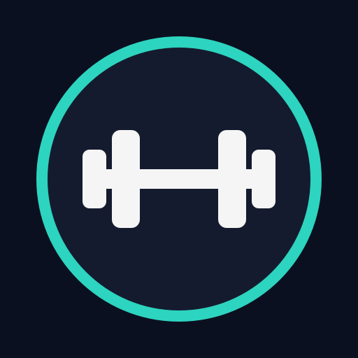

# Lift Lab

Trainings-App als PWA (Deutsch, nur lokal) mit regelbasierter Progression. Du bekommst einen Trainingsplan, loggst deine Sätze, und die App schlägt dir beim nächsten Mal Gewicht und Wiederholungen vor. Alle Daten bleiben auf deinem Gerät, es gibt kein Backend und keine Konten.

**App:** https://antoniotroiano.github.io/fitness-app/

## Funktionen

- **Planerstellung:** Wizard (Ziel, Split, Tage, Erfahrung, Fokus-Muskeln, Deload) erzeugt ein Programm. Alternativ selbst bauen oder einzelne Workouts anlegen.
- **Wochenplan:** Workouts und Ruhetage als Wochenzyklus. Sind alle Tage erledigt, startet eine neue Woche mit neu berechneten Zielen.
- **Workout-Vorschau:** Übungen, Sätze, Rep-Bereiche und Ziel-RIR. Oben die Target Muscles mit Übungs- und Satzanzahl, ein Tipp auf einen Muskel hebt die passenden Übungen hervor.
- **Logger:** Timer mit Pause, Satztabelle mit Numpad, Aufwärmsätze, Satztypen, Pausentimer, RIR pro Satz, Sätze per Swipe löschen, alle Sätze mit einer Checkbox abhaken. Das laufende Workout übersteht einen Reload.
- **Progression:** Double Progression, geschätztes 1RM (Epley), Plateau-Erkennung, Deload alle 4 Wochen, Rep-Schemata (static, linear, reverse linear, undulating).
- **Übungsbibliothek:** rund 320 Übungen mit 22 Muskelgruppen, Anleitungen, Tipps, häufige Fehler und Atmung, für viele Übungen ein Übungsbild.
- **Dashboard und Statistik:** Wochenringe (Muskeln, Sets, Übungen), Gewohnheiten, Muskelgruppen und Übungen mit Verlaufsdiagrammen.
- **Körperdaten:** Gewicht und Maße, Import aus Apple Health (XML) oder CSV.
- **Daten:** Backup als Datei exportieren und importieren, Einheiten (kg/lb, km/mi), Hell/Dunkel.

## Als App auf dem Handy nutzen

Die URL oben im Browser öffnen und „Zum Home-Bildschirm“ wählen (iPhone: Safari, Teilen-Menü). Danach läuft sie im Vollbild und funktioniert offline. Das App-Icon wird beim Hinzufügen festgelegt und lässt sich bei Web-Apps nachträglich nicht umstellen. Zum Wechseln die App vom Home-Bildschirm entfernen und neu hinzufügen.

## Hinweise und Grenzen

- Die Vorschläge sind allgemeine Trainingsheuristiken und ersetzen keine Beratung durch Trainer:innen oder Ärzt:innen.
- Kein direkter Apple-Health- oder Health-Connect-Zugriff (Web-App), nur Datei-Import.
- Die Daten liegen nur im Browser (IndexedDB). Löschen der Website-Daten löscht auch deine Einträge, daher regelmäßig ein Backup exportieren.
- Videos zu den Übungen sind bewusst noch nicht eingebaut.

## Quellen

Eigenentwicklung, Muskelfiguren und Anleitungen sind selbst erstellt. Ausnahme: Übungsbilder und übersetzte Texte aus [free-exercise-db-with-videos](https://github.com/harshvishu/free-exercise-db-with-videos) (MIT, © 2026 Arham Wani), siehe `THIRD_PARTY.md`.
